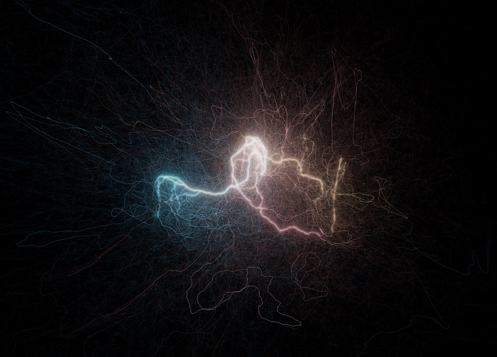
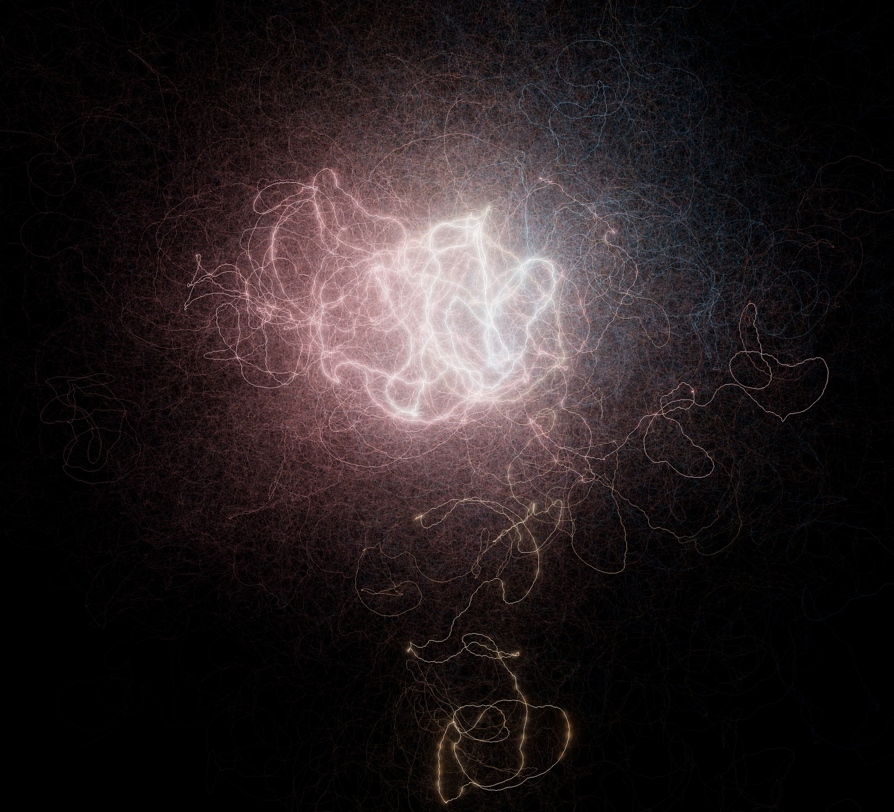
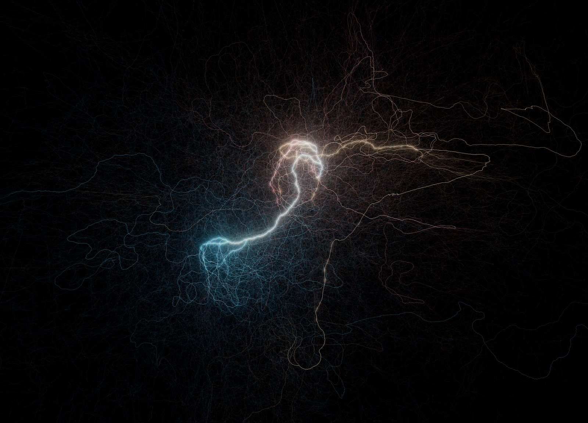

# Collatz AnglePath 3D

**[▶ Open the interactive demo](https://tzipproth.github.io/CollatzView/collatz_anglepath3d_embedded.html)**

Explore real Collatz trajectories as glowing paths in three dimensions. Shared tails form bright trunks, arithmetic rules shape the paths, and subtree colors help distinguish branches within the cloud.

The demo includes the dataset and three example views. It starts with **Save 01** and **N = 1**; choosing another view from the dropdown loads it immediately. No data import is needed. Internet access is required to load Three.js.



*Shared paths form a luminous backbone within a dense network of individual trajectories.*

## What the visualization shows

For each starting integer, the program computes the ordinary Collatz sequence:

```text
n → n / 2        if n is even
n → 3n + 1       if n is odd
```

The sequence is then drawn backwards, from **1 toward the starting value**. At each step, a local coordinate frame turns according to parity and the selected 3D rule. Trajectories with the same tail follow exactly the same path until they branch apart.

Additive blending makes frequently shared paths brighter. Their apparent thickness comes mainly from overlapping lines and glow. The integer trajectories are calculated with JavaScript `BigInt`; rotations, lengths and colors use floating-point arithmetic.

The aim is to explore common tails, branching, long outer paths and spatial groupings. The geometry depends on the chosen mapping and parameters, so a visible cluster is an experimental observation rather than a mathematical invariant.

## Two versions

| File | Purpose |
|---|---|
| [collatz_anglepath3d_embedded.html](collatz_anglepath3d_embedded.html) | Demo with `jointHist.csv` and three saved views embedded. Direct view selection; no CSV or view-file import/export. |
| [collatz_anglepath3d.html](collatz_anglepath3d.html) | Full application with external CSV loading, saved-view import/export and Saves-folder access. |
| [jointHist.csv](jointHist.csv) | Representative trajectories grouped by total steps and odd steps. |
| [Saves](Saves/) | The three supplied view files; also a convenient location for your own views. |

Both versions retain the visualization controls, Random mode, Fog, Bloom, Sparks and **Save PNG**. They run in Firefox and Chromium-based browsers, including Chrome and Edge. No application build or installation is needed.

## Run locally

Choose **Code → Download ZIP** on the repository page and extract the archive. Keep this layout:

```text
collatz_anglepath3d.html
collatz_anglepath3d_embedded.html
jointHist.csv
Saves/
Images/
```

For the quickest start, open **`collatz_anglepath3d_embedded.html`** in your browser.

For the full application, open **`collatz_anglepath3d.html`**. It tries to load `jointHist.csv` from the same directory. If the browser blocks automatic local-file access, use **Load CSV…** to select the CSV manually. Loading a CSV starts with **N = 1**.

Alternatively, serve the directory locally:

```sh
python -m http.server 8000 --bind 127.0.0.1
```

Then open [the full application](http://127.0.0.1:8000/collatz_anglepath3d.html) or [the embedded demo](http://127.0.0.1:8000/collatz_anglepath3d_embedded.html).

On GitHub Pages, the demo link at the top opens the application. In GitHub's repository file browser, an HTML link opens its source view; use the published Pages address or download the file to run it locally.

## Example views



*A dense central structure surrounded by long, looping branches.*



*Two spatial regions connected by shared paths, with warm and cool subtree colors.*

## Explore the scene

| Control | Action |
|---|---|
| Left drag | Orbit |
| Right drag | Pan |
| Mouse wheel | Zoom |
| Auto rotate | Rotate the scene continuously |
| Fit camera | Fit the current geometry into the window |
| Save PNG | Export the rendering without the interface |

Changing angles, filters, length controls or **Highest oddsteps / length** preserves the current camera. **Fit camera** explicitly reframes the scene; switching data sources also fits the camera.

Start by comparing the three demo views, then try **Syracuse drift**, adjust **3D strength**, or change **N**. Turn off Auto rotate when comparing parameter changes.

### 3D rules

The even and odd turn angles control the base path. **3D strength** scales the additional spatial rotations.

| Rule | Information mapped into the geometry |
|---|---|
| Parity + v₂ pitch | The power of two dividing an even value or `3n + 1` |
| Syracuse drift | Expansion/contraction signal `log₂(3) − k` at odd nodes |
| Syracuse word (k₁,k₂) | Two consecutive odd-to-odd halving exponents, controlling pitch and roll |
| 2-adic mod-8 classes | Residue classes of odd values modulo 8 |
| 3-adic inverse branching | Variation in pruned inverse-tree branching |
| 2×3-adic hybrid | Mod-8 classes combined with inverse-tree branching |
| Cyclic X/Y/Z | Parity turns around alternating axes, as a geometric comparison |
| Flat Wolfram-like | Planar parity turns without additional 3D rotation |

Here `v₂(x)` denotes the exponent of 2 dividing `x`, and `k = v₂(3n + 1)` is the halving exponent used by an accelerated odd-to-odd Syracuse step. The display rules scale or clamp their rotation signals.

### Colors, lengths and effects

| Color mode | Use |
|---|---|
| Magnitude | Base colors according to number size |
| Subtree at fork n[,m] | Distinguish branches at one or two chosen forks |
| Traffic (dim rare edges) | Suppress rarely shared paths to expose the common backbone |
| Deep shared branches | Highlight paths that are both far from 1 in step depth and heavily shared |
| Syracuse k class | Compare blocks with `k = 1`, `k = 2` and `k ≥ 3` |

For subtree coloring, try **Fork `40`**: its odd predecessor branch is tinted gold and its even predecessor branch cyan. A second fork, for example **`40,184`**, marks the second fork's odd branch red. **Tint strength** controls the effect.

**Length falloff** shortens segments as number size increases. **Traffic → length** lengthens frequently shared segments, which can separate forks spatially. Traffic refers to the selected trajectories, not to the CSV population counts.

**Line glow**, **Fog strength**, **Bloom** and **Sparks** control the rendering. The saved demo views include their own effect settings.

### Filters

- **Min total steps:** retain trajectories with at least the specified number of steps to 1.
- **Min relative steps:** filter by total steps divided by `log₂(start)`.
- **Min unique branch:** retain starts with a sufficiently long initial branch before joining a path shared with another start in the base selection.

## Data selection

The CSV format is:

```csv
steps,oddsteps,count,min_start,max_growth_start
```

| Column | Meaning |
|---|---|
| `steps` | Total standard Collatz steps to 1 |
| `oddsteps` | Number of odd `3n + 1` steps |
| `count` | Number of sampled starts observed in this class |
| `min_start` | Smallest sampled start in the class |
| `max_growth_start` | Sampled start in the class whose trajectory reaches the highest intermediate value |

**Highest oddsteps / length (N)** groups rows by equal total step count, then keeps the N rows with the highest odd-step counts in each group. **N = 1** selects one row per observed length; **N = 0** uses all rows.

**Start value per row** chooses `min_start`, `max_growth_start`, or **both**. If both representatives are identical, the trajectory is drawn once. Calculated step and odd-step counts are checked against the selected CSV rows.

The CSV `count` is metadata: it does not multiply a representative trajectory's brightness or width.

For comparison, **Embedded random uint64** uses a fixed sample of random 64-bit starts, with selections of **500, 1,000, 2,000 or 5,000** trajectories. Larger selections and N values can generate millions of segments and take longer to build and render.

## Save and restore views

The full application supports saving display settings and the complete camera pose:

1. Choose **Saves folder…** and select the supplied `Saves` directory, or use **Load saved Views…** to import JSON files.
2. Select a view in the dropdown and press **Load**.
3. Adjust the scene and press **Save** to export a new view. Saving turns Auto rotate off.

The list reflects the most recently read files or folder. Reading a folder again replaces the list, so deleted files disappear and changed files are refreshed.

In **Chrome/Edge**, the application can write directly to a selected folder after permission is granted. Without a connected folder, it offers a save dialog.

In **Firefox**, folder selection is for reading; saving uses the browser's download settings. Enable **Always ask you where to save files** in Firefox's download settings to choose a destination for each export. Read the Saves folder again after saving to refresh the list.

Views store filters, angles, colors, effects, segment-length settings, the Random sample size and camera state. They do **not** store or change the data source, CSV, concrete random starts, N or the start-value choice. Use the same data selection and window size to reproduce a saved image.

In the embedded demo, the three supplied views load directly from the dropdown. The first loads automatically at startup; data selection remains independently adjustable.

## Inspiration

The project extends the reversed Collatz AnglePath idea discussed in [A beautiful picture related to Collatz conjecture](https://community.wolfram.com/groups/-/m/t/558256) on Wolfram Community into an interactive 3D experiment.

